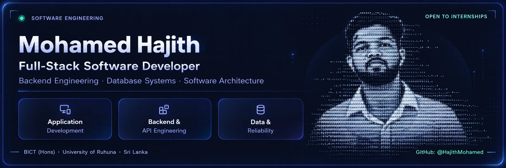

<!-- Mohamed Hajith | GitHub Profile README | Recruiter-focused design -->

<picture>
  <source media="(prefers-color-scheme: dark)" srcset="./assets/banner-dark.webp" />
  <source media="(prefers-color-scheme: light)" srcset="./assets/banner-light.webp" />
  
</picture>

 

**Third-year BICT (Hons) undergraduate · Faculty of Technology, University of Ruhuna · Sri Lanka**

I build practical web applications, secure APIs and database-driven business systems.

[**Portfolio**](https://www.hzlabs.studio/) &nbsp;·&nbsp; [**LinkedIn**](https://www.linkedin.com/in/mohamed-hajith-b53559295/) &nbsp;·&nbsp; [**Email**](mailto:ahammedlebbehajith@gmail.com) &nbsp;·&nbsp; [**Repositories**](https://github.com/HajithMohamed?tab=repositories)

---

## 👋 A little about me

I'm **Mohamed Hajith**, a developer focused on **React/Next.js, Node.js APIs, and SQL/NoSQL databases**. I enjoy turning requirements into usable features, understanding how data moves through a system, and improving correctness with automated tests and code reviews.

- **I work on:** full-stack applications, authentication and permissions, REST APIs, relational data models, and business workflows.
- **I value:** understandable code, database integrity, realistic testing, documentation, and collaborative Git workflows.
- **My next step:** a software engineering internship or junior role where I can contribute to a product and learn from experienced engineers.

**Core stacks:** TypeScript · React / Next.js · Node.js / Express · PostgreSQL, and Java · Spring Boot · MySQL.

## ⭐ Highlights

- **Lead developer on a live e-commerce site.** Saga Elite, for a Sri Lankan fashion brand: 440 of the project's 670 commits, in a team of four.
- **Rules enforced by the database.** BenchBook blocks double bookings with a PostgreSQL exclusion constraint, backed by 385 automated tests and full CI.
- **Data engineering.** LankaGrid loads 107,115 fifteen-minute grid dispatch records into a Kimball data warehouse, with 24 analytical SQL queries and 109 tests (team of six).
- **Testing as a habit.** TechBridge has 879 backend unit tests plus Playwright end-to-end specs.

## 🚀 Selected engineering work

### 01 · [Saga Elite — E-commerce platform](https://github.com/Hz-Labs-studio/Saga-Elite-Web-project)
**Team project · React, Redux, Node.js, Express, MongoDB, Socket.IO**

Led a four-member academic development team and contributed to full-stack functionality, REST APIs, authentication, real-time events and automated Playwright checks. The project also includes OCR-assisted receipt processing and an optional AI-assisted review moderation integration.

**[Source code](https://github.com/Hz-Labs-studio/Saga-Elite-Web-project)** · **[Live application](https://saga-elite.shop/)**

### 02 · [BenchBook — Lab resource reservation](https://github.com/HajithMohamed/Medical-Lab-Resource-Reservation-System)
**Independent technical assessment · Next.js, TypeScript, PostgreSQL, Prisma, Vitest**

Built resource booking and maintenance workflows. The standout design decision is **database-enforced reservation conflict prevention**, supported by documented architecture decisions and automated tests.

**[Source code & technical documentation](https://github.com/HajithMohamed/Medical-Lab-Resource-Reservation-System)**

### 03 · [LankaGrid — Electricity grid data warehouse](https://github.com/HajithMohamed/LankaGrid-Analytics)
**Team project (six members) · Python, PostgreSQL, SQL, Next.js, GitHub Actions**

A Kimball data warehouse for Sri Lanka's national electricity grid. A Python ETL pipeline loads official CEB, PUCSL and NASA data with SHA-256 provenance and quarantine of bad rows. 24 analytical SQL queries use window functions, `ROLLUP` and `CUBE`, and a Next.js dashboard presents the results. CI runs the tests against PostgreSQL 18.

**[Source code & dashboard screenshots](https://github.com/HajithMohamed/LankaGrid-Analytics)**

### 04 · [TechBridge — Student opportunity platform](https://github.com/HajithMohamed/Tech_Bridge)
**React, TypeScript, Express, MongoDB, Vitest, Playwright**

Connects technology students with jobs, internships, scholarships, mentors and hardware to borrow, through separate student, provider and admin portals. Opportunity matching is rule-based scoring, not a trained ML model. The backend has 879 unit tests.

**[Source code](https://github.com/HajithMohamed/Tech_Bridge)**

### 05 · [Shoe Bank — Footwear business management](https://github.com/HajithMohamed/Footwear_Business_Management_System)
**Independent project · PHP, MySQL, custom MVC, Tailwind CSS, Docker**

Built business workflows for stock tracking, invoicing, customer credit, cheques and financial reporting. The implementation distinguishes **profit from collected cash** and includes OCR-assisted document processing.

**[Source code](https://github.com/HajithMohamed/Footwear_Business_Management_System)**

<strong>More work — TaskFlow, HZ Labs, Java and database collaborations</strong>

- **[TaskFlow](https://github.com/HajithMohamed/TODO_App)**: a Next.js and Supabase task manager with realtime updates across tabs and PostgreSQL row-level security on every table.
- **[HZ Labs portfolio and CMS](https://github.com/HajithMohamed/my_portfoli_website)**: a Next.js and NestJS portfolio with an authenticated content management interface ([live website](https://www.hzlabs.studio/)).
- **[Faculty Event Management System](https://github.com/AKMJafran/EventManagementSystem)**: a collaborative React, Spring Boot and MySQL project with authentication, role-based access and event scheduling.
- **[BloodBridge database work, merged PR #7](https://github.com/akalanka001/-BloodBridge--ADBMS/pull/7)**: PostgreSQL contracts, transaction safeguards and authorisation checks for a collaborative academic prototype. Academic demonstration only, not a clinical product.

## 🧰 Engineering toolkit

The technologies below are used in my academic, independent and collaborative projects. Icons make the stack easier to scan; the project repositories above show how I have applied them.

### Languages & web fundamentals

  

`JavaScript` · `TypeScript` · `Java` · `PHP` · `HTML` · `CSS`

### Frontend & backend

  

`React` · `Next.js` · `Node.js` · `Express` · `NestJS` · `Spring Boot` · `Redux Toolkit` · `Tailwind CSS`

### Data, databases & engineering tools

  

`PostgreSQL / PL/pgSQL` · `MySQL` · `MongoDB` · `Prisma` · `Python (pandas, psycopg) for ETL` · `Docker Compose` · `Git / pull requests` · `GitHub Actions` · `Playwright` · `Vitest` · `Postman`

### 📖 Currently learning

  

**Exploring:** Flutter/Dart, Microsoft Azure fundamentals, applied AI and data science. These are learning areas, not claims of advanced professional experience.

## 🧪 How I approach development

**Understand the problem → design the data/API contracts → implement in small steps → test edge cases → review and improve.**

I use AI-assisted development tools when useful, but focus on understanding the output, checking it against requirements, and validating behavior through code inspection and tests.

## 🎓 Education & contact

**Bachelor of Information and Communication Technology (Honours) — BICT (Hons)**  
Faculty of Technology, **University of Ruhuna**, Sri Lanka  
Third-year undergraduate · Expected graduation: **2027**

- **Portfolio:** https://www.hzlabs.studio/
- **LinkedIn:** https://www.linkedin.com/in/mohamed-hajith-b53559295/
- **Email:** [ahammedlebbehajith@gmail.com](mailto:ahammedlebbehajith@gmail.com)

*Building useful systems, improving one engineering decision at a time.*

